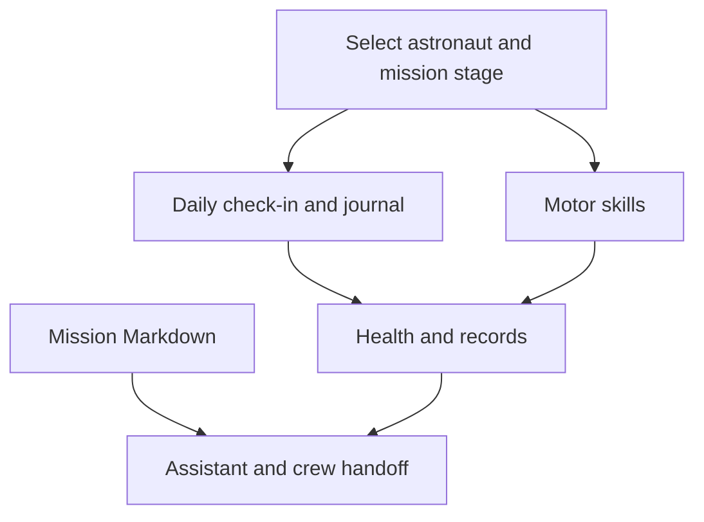

# NETIN

NETIN is a Windows workstation for astronaut health check-ins during space missions. It combines daily observations, vital signs, a crew journal and motor skills into a local record. Qwen through Ollama helps astronauts review those records and consult imported mission documents.

[Download NETIN for Windows](https://github.com/nxczmain/Nasa-Space-Apps/raw/refs/heads/main/downloads/NETIN-Windows-x64.zip) · [Complete setup for judges](docs/INSTALLATION.md) · [NASA Space Apps challenge](https://www.spaceappschallenge.org/2026/challenges/health-monitoring-software/)

## Contents

1. [About the project](#about-the-project)
2. [What you can evaluate](#what-you-can-evaluate)
3. [Installation](#installation)
4. [How it works](#how-it-works)
5. [Repository layout](#repository-layout)
6. [Research references](#research-references)

## About the project

Crew members log changes in how they feel, what they measured and how well they can work. NETIN helps them review that information and prepare a clearer handoff to the crew medical officer. The mission stage is shared across crew profiles on the same installation. Health records remain associated with each astronaut and the stage where they were recorded.

## What you can evaluate

| Area | What to try |
| --- | --- |
| Home | Read the check-in recap, journal, relevant follow-ups and vital signs |
| Assistant | Ask a question from the mission library, describe how you feel, or simulate an emergency handoff |
| Health | Explore seven-day trends, the body map, journal patterns and motor tests |
| Records | Browse two synthetic 30-day astronaut histories, including values, interviews and game results |
| Documents | Load a local Markdown folder and inspect the references NETIN uses |

## Installation

Download the Windows x64 ZIP from GitHub and extract it to a folder on your PC, such as `Documents\NETIN`. Open Ollama on that PC and run `ollama pull qwen3:4b`. Start `NETIN.exe` from the extracted folder, try Maya Chen or Mateo Ruiz, then import the included `ReferenceLibrary` folder from **Documents**. The [judges' guide](docs/INSTALLATION.md) covers prerequisites, demo passwords, sample questions and troubleshooting.

## How it works

NETIN runs in a WinForms shell with WebView2. It matches questions to local Markdown passages and sends relevant text to Qwen on the same machine. Emergency reports first trigger a built-in action. For an unresponsive person, the model can then extract a directly reported observation for the medical handoff. See the [architecture notes](docs/ARCHITECTURE.md) for the data flow and technology stack.

## Repository layout

| Directory | Contents |
| --- | --- |
| [app](app/) | Desktop host, interface, model integration and build script |
| [docs](docs/) | Installation and evaluation guide, architecture notes |
| [downloads](downloads/) | Windows x64 ZIP and its SHA-256 checksum |
| [references](references/) | Public Markdown references for the demo |

## Research references

- NASA Human Research Program [human spaceflight hazards](https://www.nasa.gov/hrp/hazards/) and [risks from inadequate sleep and irregular schedules](https://www.nasa.gov/reference/risk-from-inadequate-sleep-and-irregular-schedules/).
- NASA Office of the Chief Health and Medical Officer [in-flight medical care](https://www.nasa.gov/ochmo/health-and-medical-systems/in-flight-medical-care/).
- American Red Cross [first aid for an unresponsive person](https://www.redcross.org/take-a-class/resources/learn-first-aid/unresponsive-and-breathing-person), a terrestrial reference.

NETIN is a prototype for Space Apps. Operational use requires clinical validation and mission approval. The public download uses synthetic records and a small public demo library.
