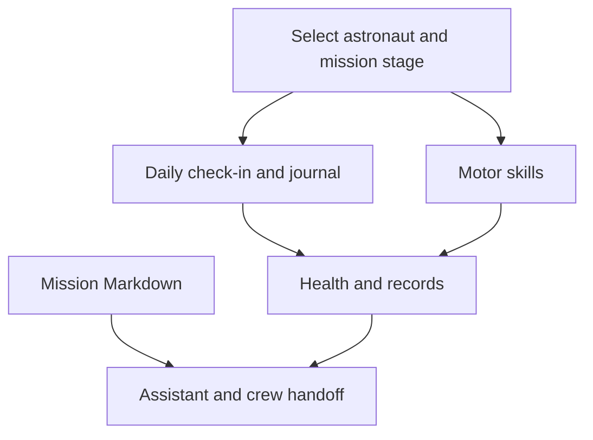

# NETIN

NETIN is a Windows workstation for astronaut health check-ins during space missions. It combines daily observations, vital signs, a crew journal and motor skills into a local record. Qwen through Ollama helps astronauts review those records and consult imported mission documents.

[Download NETIN for Windows](https://github.com/nxczmain/Nasa-Space-Apps/raw/refs/heads/main/downloads/NETIN-Windows-x64.zip) · [Complete setup for judges](docs/INSTALLATION.md) · [NASA Space Apps challenge](https://www.spaceappschallenge.org/2026/challenges/health-monitoring-software/)

## Contents

1. [About the project](#about-the-project)
2. [What you can evaluate](#what-you-can-evaluate)
3. [Installation](#installation)
4. [Install the Markdown data for the AI](#install-the-markdown-data-for-the-ai)
5. [How it works](#how-it-works)
6. [Repository layout](#repository-layout)
7. [Research references](#research-references)

## About the project

Crew members log changes in how they feel, what they measured and how well they can work. NETIN helps them review that information and prepare a clearer handoff to the crew medical officer. The mission stage is shared across crew profiles on the same installation. Health records remain associated with each astronaut and the stage where they were recorded.

## What you can evaluate

| Area | What to try |
| --- | --- |
| Home | Read the check-in recap, journal, relevant follow-ups and vital signs |
| Assistant | Ask Ham a question from the mission library, describe how you feel, or simulate an emergency handoff |
| Health | Explore trends for today, 7 days or 30 days, log symptoms on the body map and review motor tests |
| Records | Browse two synthetic 30-day astronaut histories, including values, interviews and game results |
| Documents | Load a local Markdown folder and inspect the references NETIN uses |

## Installation

Download the Windows x64 ZIP from GitHub and extract it to a folder on your PC, such as `Documents\NETIN`. Open Ollama on that PC and run `ollama pull qwen3:4b`. Start `NETIN.exe` from the extracted folder and try Maya Chen or Mateo Ruiz. The included demo references open in **Documents**, where you can also load another Markdown folder. The [judges' guide](docs/INSTALLATION.md) covers prerequisites, demo passwords, sample questions and troubleshooting.

## Install the Markdown data for the AI

The Windows app download includes a small demo library. **Download and import the Markdown data separately so Ham can consult the full project research collection.**

1. Download the [repository ZIP](https://github.com/nxczmain/Nasa-Space-Apps/archive/refs/heads/main.zip), or use **Code → Download ZIP** on the repository page. Extract the ZIP completely.
2. Inside the extracted `Nasa-Space-Apps-main` folder, find [`Investigation (.md)`](Investigation%20%28.md%29/). Copy that entire folder, including all its topic subfolders and `.md` files, into your NETIN installation folder. For the installation example above, use `Documents\NETIN\Investigation (.md)`.

   | Example location | Contents |
   | --- | --- |
   | `Documents\NETIN\NETIN.exe` | The NETIN application |
   | `Documents\NETIN\Investigation (.md)\` | The complete Markdown folder and its topic subfolders |

   You can keep the Markdown folder in another local location; select that location in the next step.

3. Start `NETIN.exe`, sign in, and open **Documents → Load Markdown folder**. Select the parent **Investigation (.md)** folder so NETIN includes every topic subfolder. Confirm the folder selection if Windows asks.
4. Wait for **Reading … documents** to finish. In **Local library**, confirm that the documents are listed, search for a topic, and open a document. The collection has **503 research documents plus its README**, so importing the whole folder normally lists **504 Markdown files**.
5. Keep Ollama running. In **Settings → Check connection**, confirm **Qwen is ready**, then open **Assistant** and ask a document-based question, such as “What does the research library say about sleep and fatigue?” Review the reference passages shown with the answer.

**Complete the import in step 3 after copying the files.** NETIN uses the imported Markdown text to find relevant passages and provide context to Qwen. The PDF originals are available in [`investigation`](investigation/) for checking figures, tables and formatting.

Use **Load Markdown folder** again after adding or editing source files. Loading a folder replaces the previously imported library, so select the complete `Investigation (.md)` folder each time. See the [research library guide](docs/RESEARCH.md) for the topic index and file checksums.

## How it works

NETIN runs in a WinForms shell with WebView2. It matches questions to local Markdown passages and sends relevant text to Qwen on the same machine. Emergency reports first trigger a built-in action. For an unresponsive person, the model can then extract a directly reported observation for the medical handoff. See the [architecture notes](docs/ARCHITECTURE.md) for the data flow and technology stack.

## Repository layout

| Directory | Contents |
| --- | --- |
| [app](app/) | Desktop host, interface, model integration and build script |
| [docs](docs/) | Installation and evaluation guide, architecture notes |
| [downloads](downloads/) | Windows x64 ZIP and its SHA-256 checksum |
| [references](references/) | Public Markdown references for the demo |
| [investigation](investigation/) | 510 original research PDFs, grouped by topic |
| [Investigation (.md)](Investigation%20%28.md%29/) | 503 Markdown research documents and the import manifest |

## Research references

The complete [research library](docs/RESEARCH.md) includes PDF originals and their Markdown counterparts. To use it in NETIN, open **Documents** and select the local `Investigation (.md)` folder. The guide lists the categories, document counts and file checksums.

- NASA Human Research Program [human spaceflight hazards](https://www.nasa.gov/hrp/hazards/) and [risks from inadequate sleep and irregular schedules](https://www.nasa.gov/reference/risk-from-inadequate-sleep-and-irregular-schedules/).
- NASA Office of the Chief Health and Medical Officer [in-flight medical care](https://www.nasa.gov/ochmo/health-and-medical-systems/in-flight-medical-care/).
- American Red Cross [first aid for an unresponsive person](https://www.redcross.org/take-a-class/resources/learn-first-aid/unresponsive-and-breathing-person), a terrestrial reference.

NETIN is a prototype for Space Apps. Operational use requires clinical validation and mission approval. The public download uses synthetic records and a small public demo library.
