

  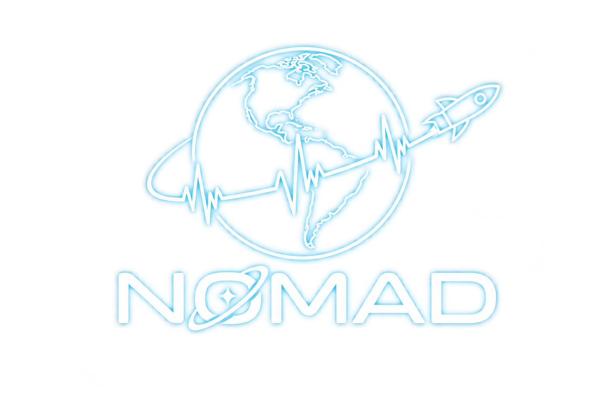

# NOMAD

**A local health workstation for astronaut crews.** Log daily observations, review changes across a mission stage, look up onboard references and prepare a handoff for the crew medical officer. The Windows application opens as `NETIN.exe`.

[**Download for Windows**](https://github.com/nxczmain/NOMAD_Health_Project/releases/latest/download/NETIN-Windows-x64.zip) · [Quick start](#quick-start) · [App screenshots](#app-screenshots) · [Sources and references](#sources-and-references) · [Repository map](#repository-map) · [Bug Fixes](BUG-FIXES.md) · [Installation](docs/INSTALLATION.md)

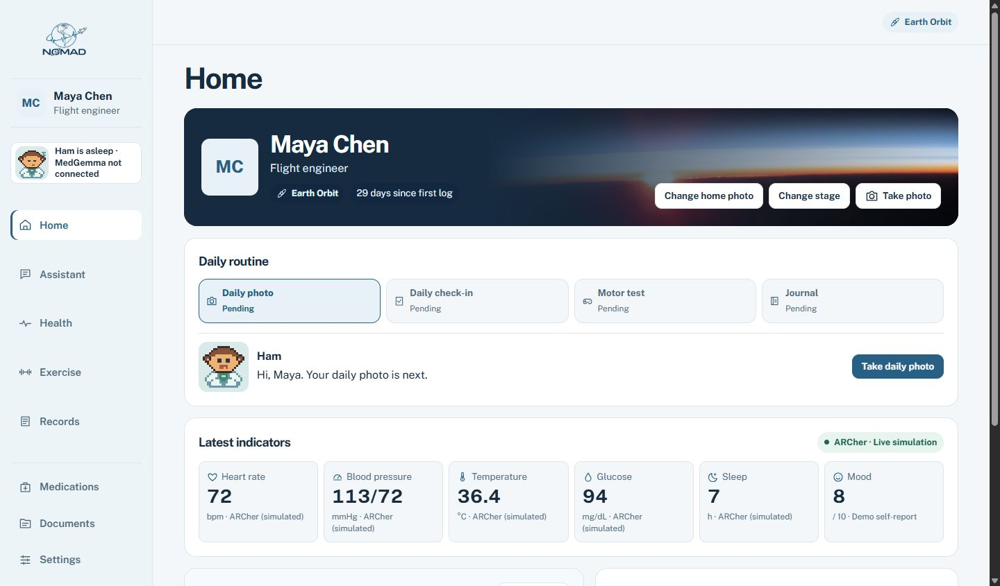

## Quick start

Practice with the bundled Earth Orbit demo and its simulated crew data.

1. **Open the demo.** Extract the Windows ZIP, launch **NETIN.exe** and select **Earth Orbit**. Sign in as **Maya Chen** with `OrbitDemo26`.
2. **Start a check-in.** In **Assistant → Daily check-in**, select **Start today’s check-in**. For this practice scenario, answer **No** to the immediate-help question and enter `Physically I feel just a little headache`.
3. **Save the observation.** Choose **4 / 10**, select **Save pain rating** and then **Save and finish** when the next prompt appears. Open **Records** to review today’s check-in or **Health → Physical → Body map** to see the reported area.
4. **Find a source.** In **Documents**, search for `ISS`, open **ISS Medical Checklist (2001) · Full manual**, then choose **ACLS algorithm** (PDF page 117) or **CPR** (PDF page 145).

For model-backed chat and medical review, start Ollama and open **Settings → Local assistant**. Use **Check connection** and **Download required models** if prompted. Under **Medical model**, select **Test and use model**. [Installation and troubleshooting](docs/INSTALLATION.md) · [Full demo tutorial](docs/QUICKSTART.md) · [Ham practice scenarios](docs/HAM-SIMULATIONS.md)

> NOMAD is a research prototype. Operational use requires clinical validation and mission approval. Follow the approved checklist for the current mission and the crew medical officer.

## App screenshots

Select an image to see it at full size or select a screen name for its controls and workflow.

<table>
  <tr><td width="50%"><a href="docs/images/app/05-daily-check-in.jpg">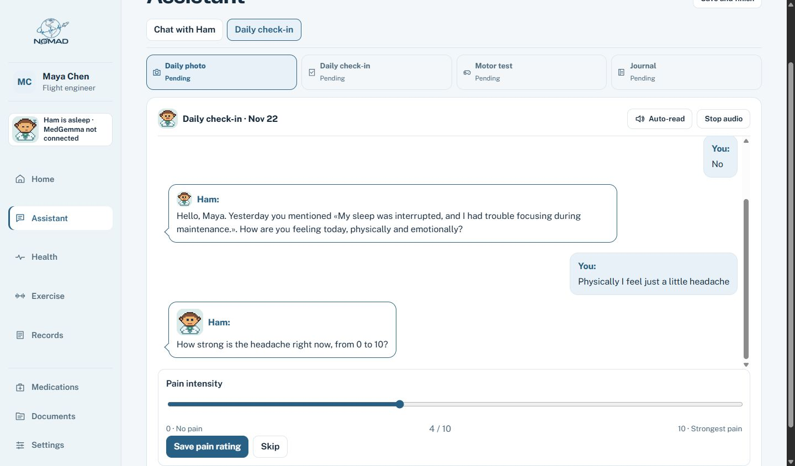</a> <strong><a href="docs/APP-GUIDE.md#guided-daily-check-in">Guided daily check-in</a></strong> Answer guided questions and save a reported intensity.</td><td width="50%"><a href="docs/images/app/08-body-map.jpg">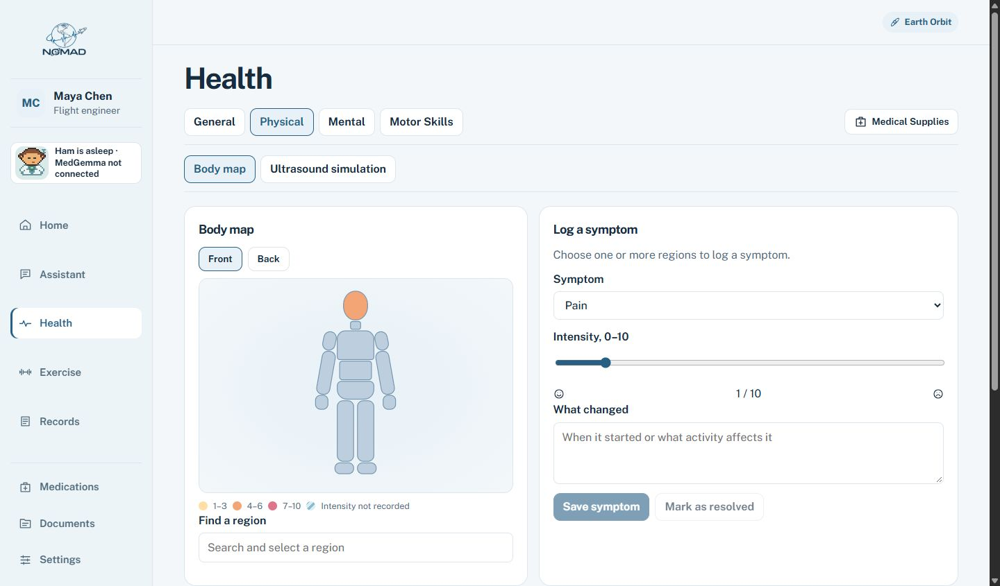</a> <strong><a href="docs/APP-GUIDE.md#body-map">Body map</a></strong> Mark the body region and record a symptom.</td></tr>
  <tr><td width="50%"><a href="docs/images/app/10-mental-health.jpg">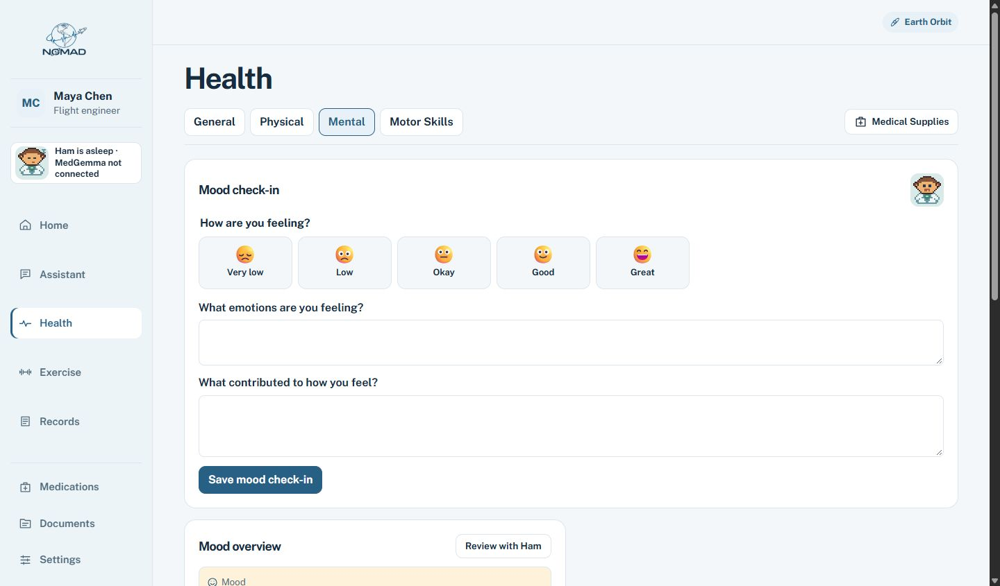</a> <strong><a href="docs/APP-GUIDE.md#mental-health">Mental health</a></strong> Record a mood check-in and review recent entries.</td><td width="50%"><a href="docs/images/app/14-exercise.jpg">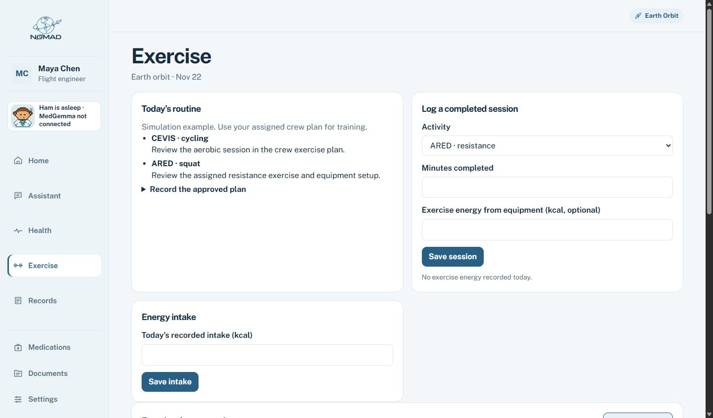</a> <strong><a href="docs/APP-GUIDE.md#exercise">Exercise</a></strong> Review the assigned routine and log a completed session.</td></tr>
  <tr><td width="50%"><a href="docs/images/app/16-records.jpg">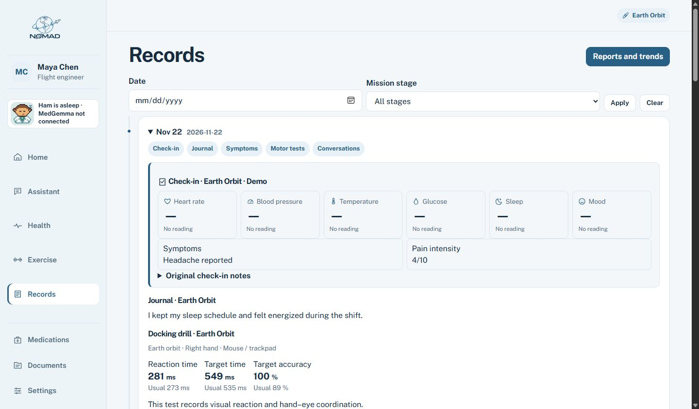</a> <strong><a href="docs/APP-GUIDE.md#records">Records</a></strong> Find saved check-ins and export a daily report.</td><td width="50%"><a href="docs/images/app/20-document-reader.jpg">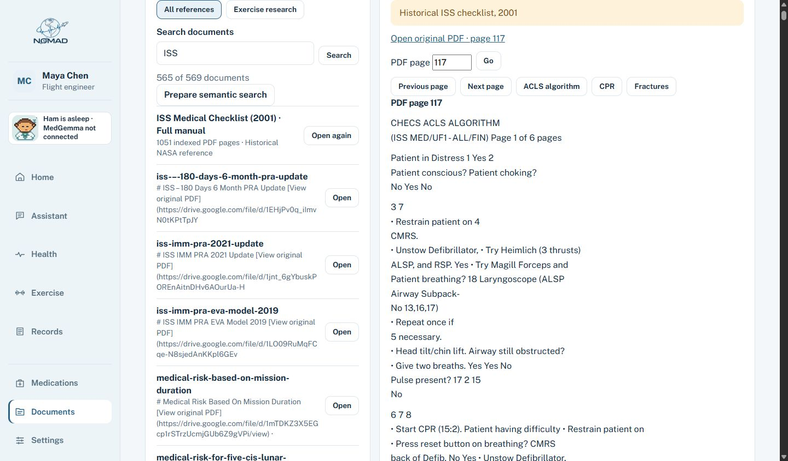</a> <strong><a href="docs/APP-GUIDE.md#document-reader">Document reader</a></strong> Open the ISS checklist and jump to a source page.</td></tr>
</table>

<strong>Crew profiles and daily workflow</strong>

<table>
  <tr><td width="50%"><a href="docs/images/app/01-crew-roster.jpg">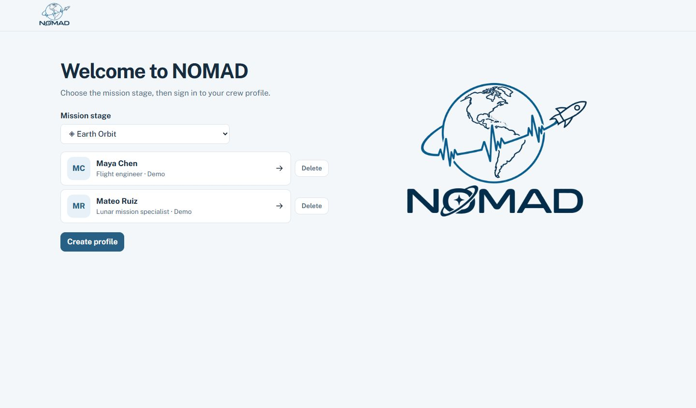</a> <strong><a href="docs/APP-GUIDE.md#crew-roster">Crew roster</a></strong> Pick a mission stage and sign in to a local crew profile.</td><td width="50%"><a href="docs/images/app/02-create-profile.jpg">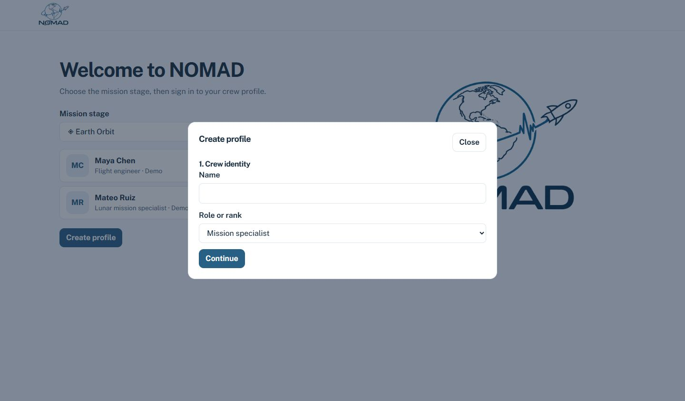</a> <strong><a href="docs/APP-GUIDE.md#create-profile">Create profile</a></strong> Create a local profile and select its role.</td></tr>
  <tr><td width="50%"><a href="docs/images/app/22-daily-photo.jpg">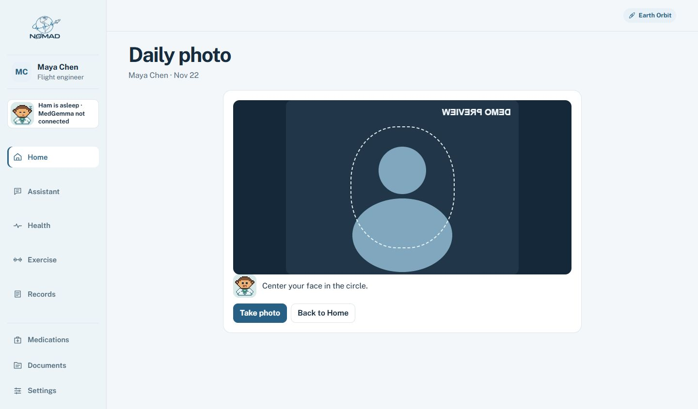</a> <strong><a href="docs/APP-GUIDE.md#daily-photo">Daily photo</a></strong> Preview and save the optional daily photo.</td><td width="50%"><a href="docs/images/app/04-ham-chat.jpg">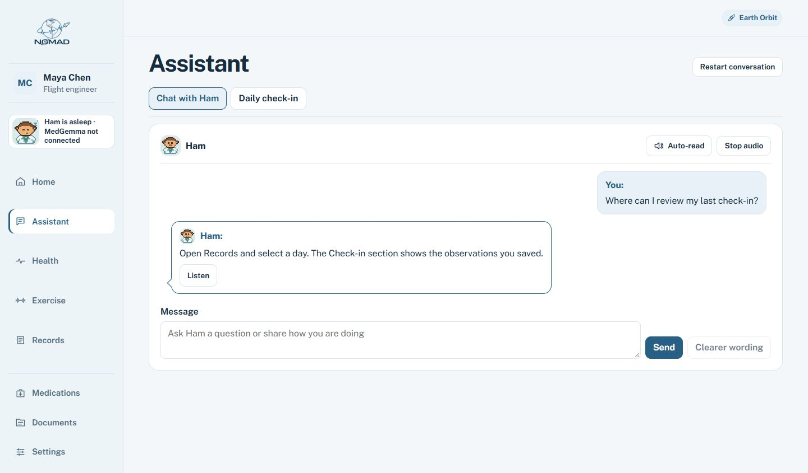</a> <strong><a href="docs/APP-GUIDE.md#chat-with-ham">Chat with Ham</a></strong> Ask Ham a question and inspect the sources cited in a reply.</td></tr>
  <tr><td width="50%"><a href="docs/images/app/06-check-in-workspace.jpg">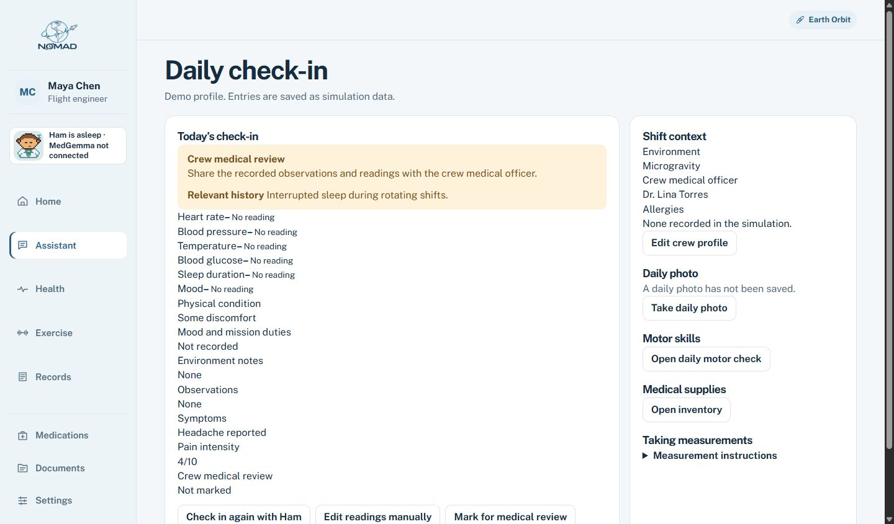</a> <strong><a href="docs/APP-GUIDE.md#check-in-workspace">Check-in workspace</a></strong> Review check-in status and continue the daily routine.</td><td width="50%"><a href="docs/images/app/12-motor-skill-activities.jpg">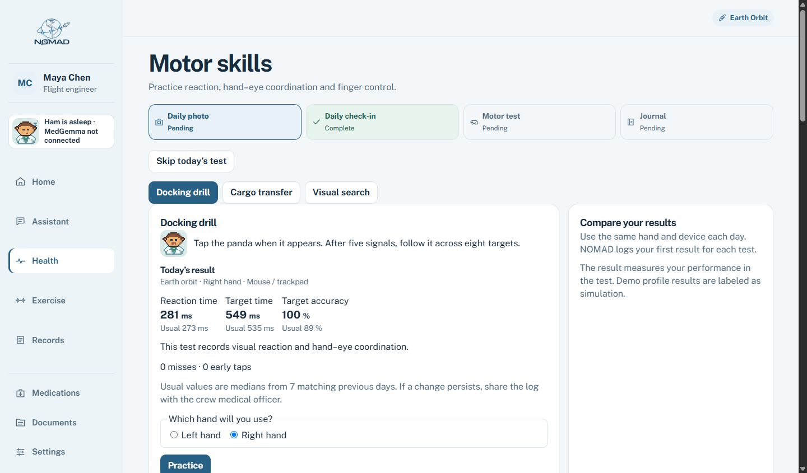</a> <strong><a href="docs/APP-GUIDE.md#motor-skill-activities">Motor skill activities</a></strong> Practice visual search, reaction and coordination.</td></tr>
  <tr><td width="50%"><a href="docs/images/app/13-journal.jpg">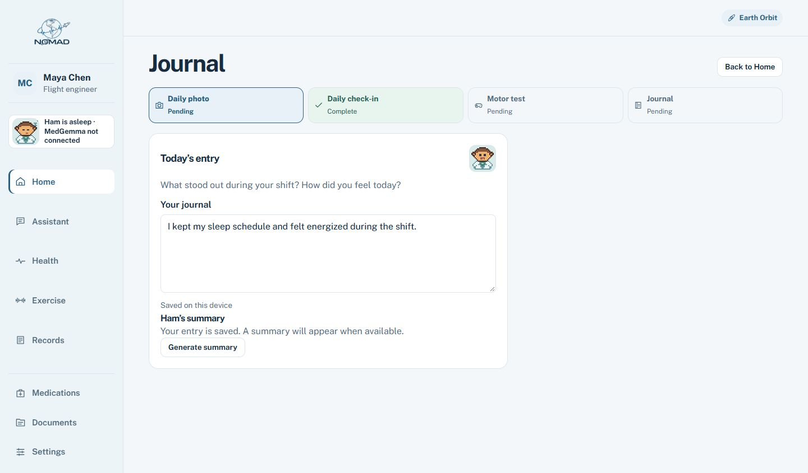</a> <strong><a href="docs/APP-GUIDE.md#journal">Journal</a></strong> Write a daily note that saves as you type.</td><td></td></tr>
</table>

<strong>Health, exercise, records and medical supplies</strong>

<table>
  <tr><td width="50%"><a href="docs/images/app/07-health-general.jpg">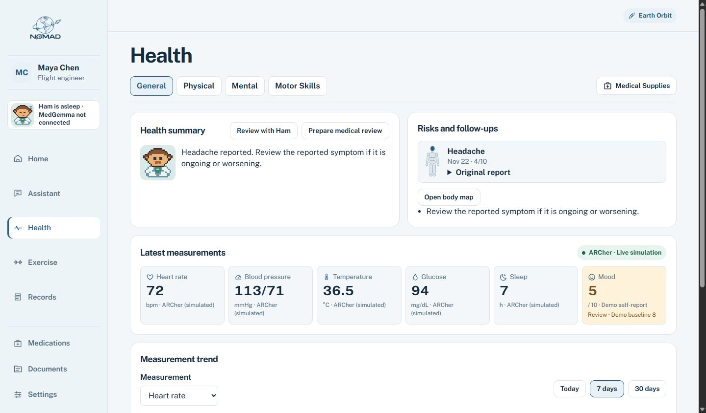</a> <strong><a href="docs/APP-GUIDE.md#health-overview">Health overview</a></strong> Review recent observations, measurements and charts.</td><td width="50%"><a href="docs/images/app/09-ultrasound.jpg">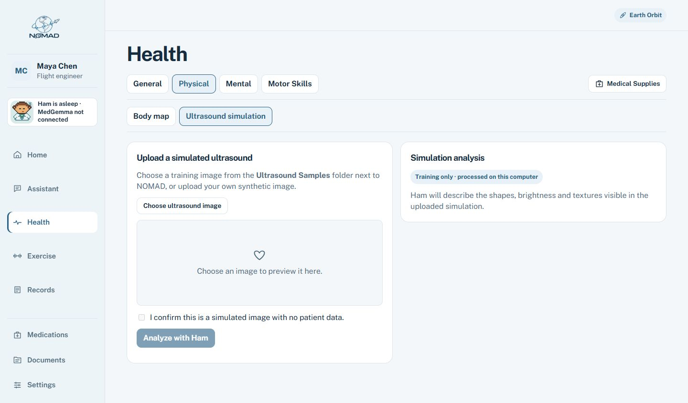</a> <strong><a href="docs/APP-GUIDE.md#ultrasound-simulation">Ultrasound simulation</a></strong> Analyze a synthetic ultrasound sample.</td></tr>
  <tr><td width="50%"><a href="docs/images/app/11-motor-skill-results.jpg">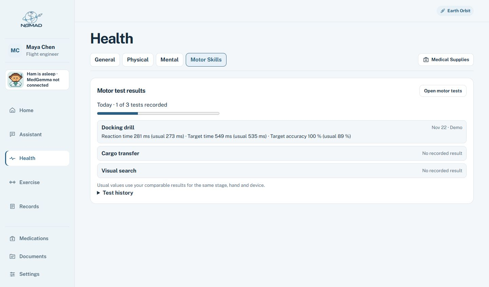</a> <strong><a href="docs/APP-GUIDE.md#motor-skill-results">Motor skill results</a></strong> Review saved scores for the signed-in profile and stage.</td><td width="50%"><a href="docs/images/app/26-medical-review.jpg">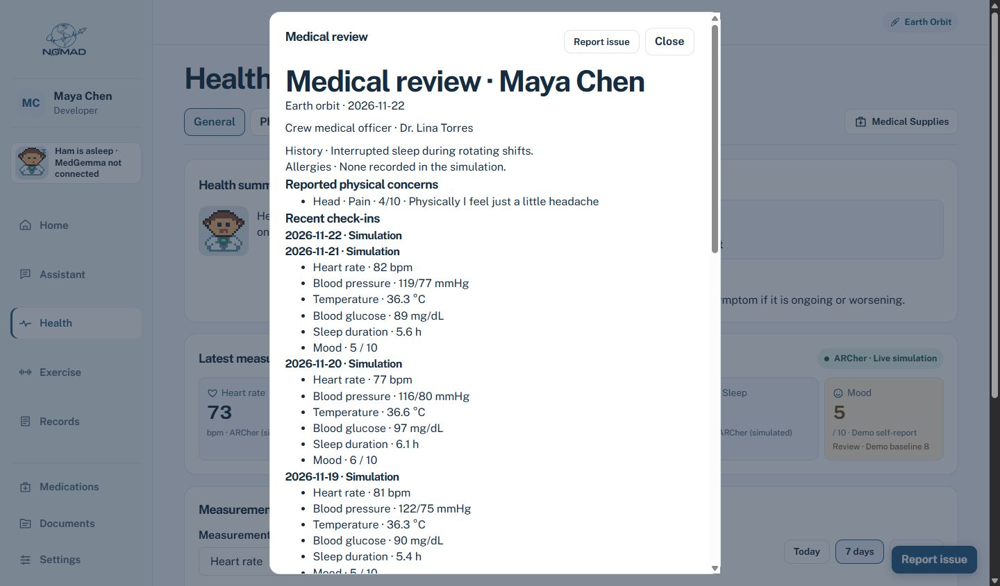</a> <strong><a href="docs/APP-GUIDE.md#medical-review">Medical review</a></strong> Prepare and export a handoff for the crew medical officer.</td></tr>
  <tr><td width="50%"><a href="docs/images/app/15-exercise-demonstrations.jpg">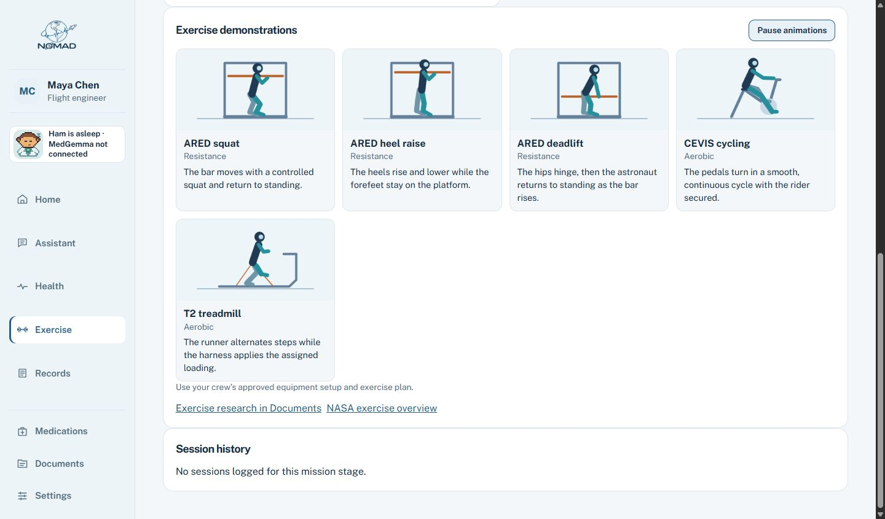</a> <strong><a href="docs/APP-GUIDE.md#exercise-demonstrations">Exercise demonstrations</a></strong> Play or pause five offline movement demonstrations.</td><td width="50%"><a href="docs/images/app/17-reports-and-trends.jpg">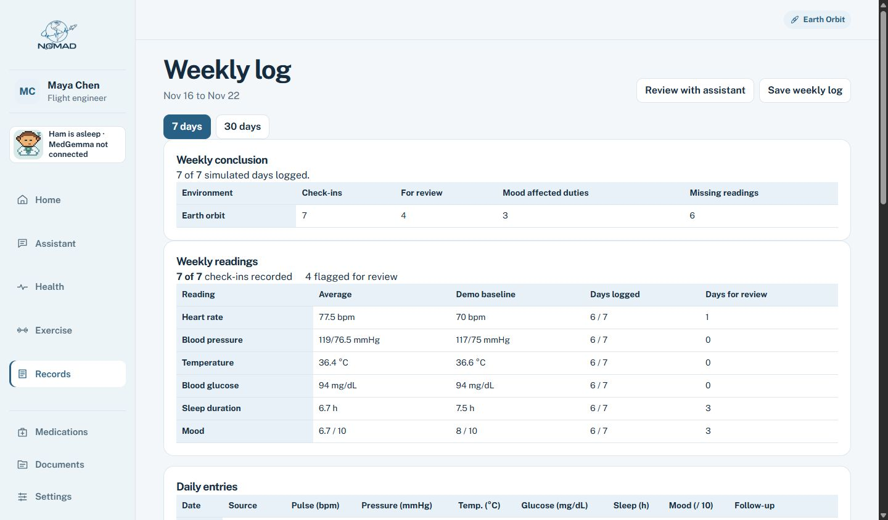</a> <strong><a href="docs/APP-GUIDE.md#reports-and-trends">Reports and trends</a></strong> Review 7-day or 30-day log summaries.</td></tr>
  <tr><td width="50%"><a href="docs/images/app/18-medications.jpg">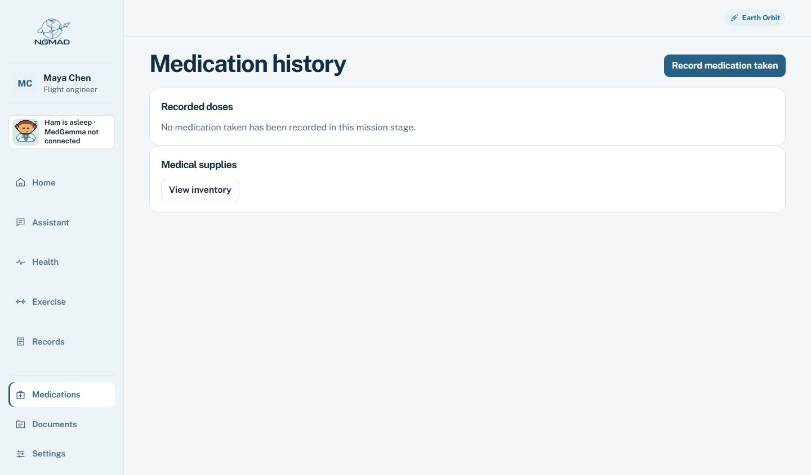</a> <strong><a href="docs/APP-GUIDE.md#medication-history">Medication history</a></strong> See doses already logged for this mission stage.</td><td width="50%"><a href="docs/images/app/27-record-medication.jpg">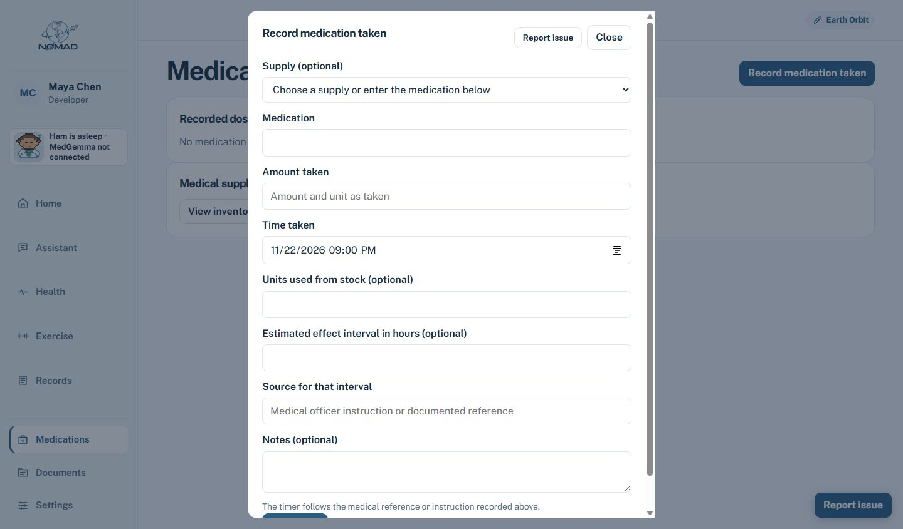</a> <strong><a href="docs/APP-GUIDE.md#record-medication-taken">Record medication taken</a></strong> Log a dose already taken and any confirmed inventory use.</td></tr>
  <tr><td width="50%"><a href="docs/images/app/21-medical-supplies.jpg">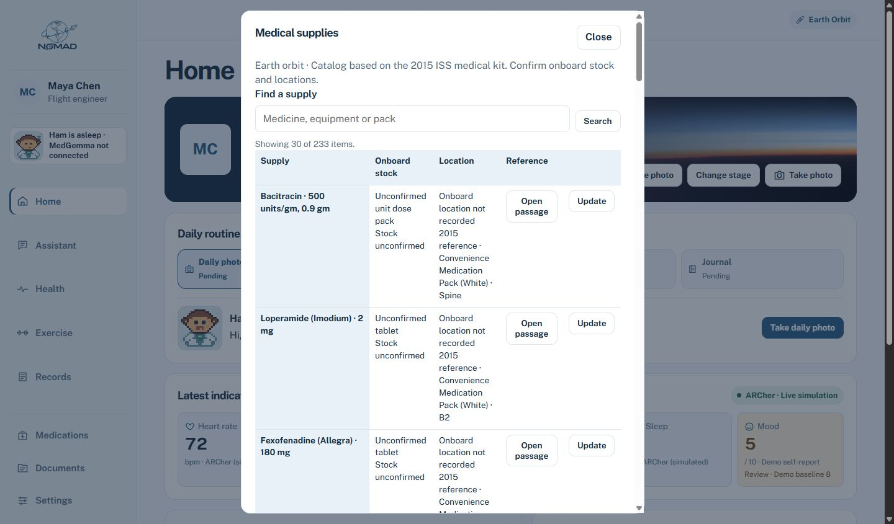</a> <strong><a href="docs/APP-GUIDE.md#medical-supplies">Medical supplies</a></strong> Review the medical kit catalog and confirm stock.</td><td></td></tr>
</table>

<strong>Library, settings and developer tools</strong>

<table>
  <tr><td width="50%"><a href="docs/images/app/19-documents.jpg">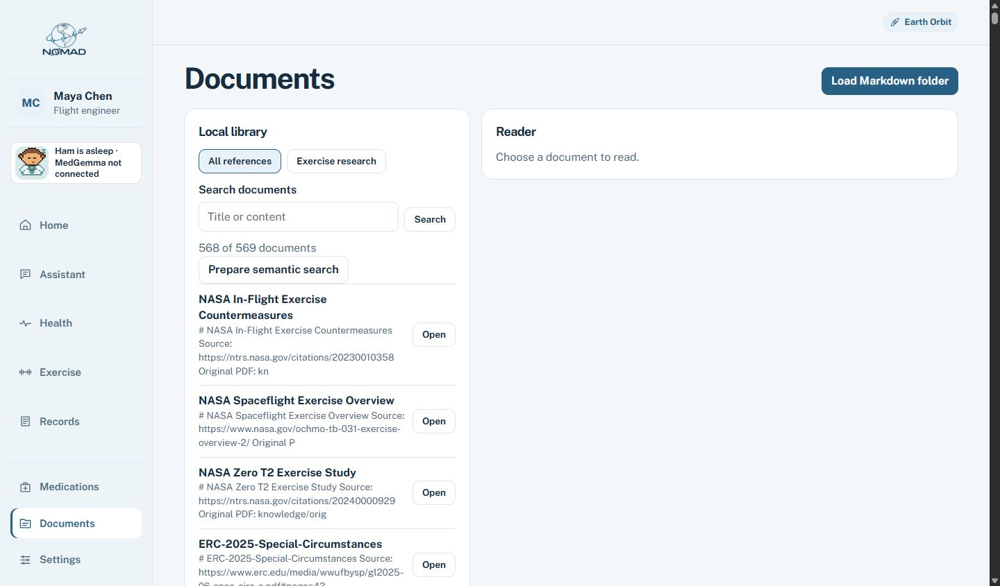</a> <strong><a href="docs/APP-GUIDE.md#documents">Documents</a></strong> Search the local library or import Markdown references.</td><td width="50%"><a href="docs/images/app/23-settings.jpg">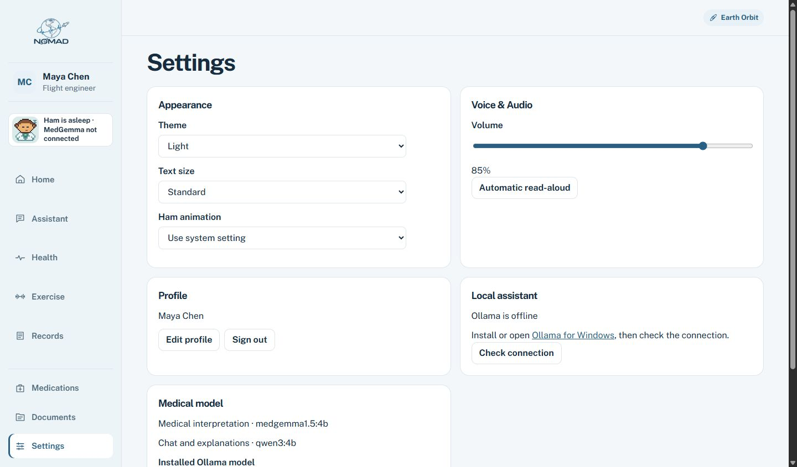</a> <strong><a href="docs/APP-GUIDE.md#settings">Settings</a></strong> Adjust appearance, audio and profile settings.</td></tr>
  <tr><td width="50%"><a href="docs/images/app/24-profile-settings.jpg">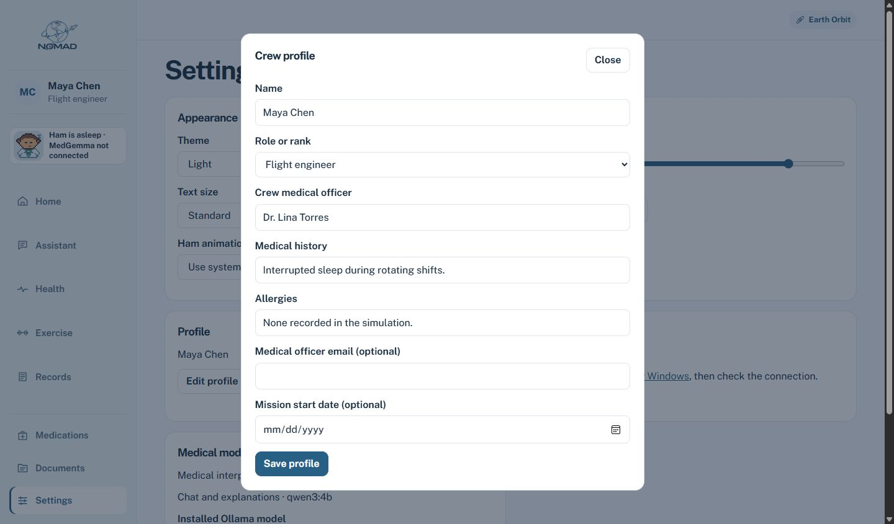</a> <strong><a href="docs/APP-GUIDE.md#profile-settings">Profile settings</a></strong> Update the crew role and medical contact.</td><td width="50%"><a href="docs/images/app/28-local-assistant-setup.jpg">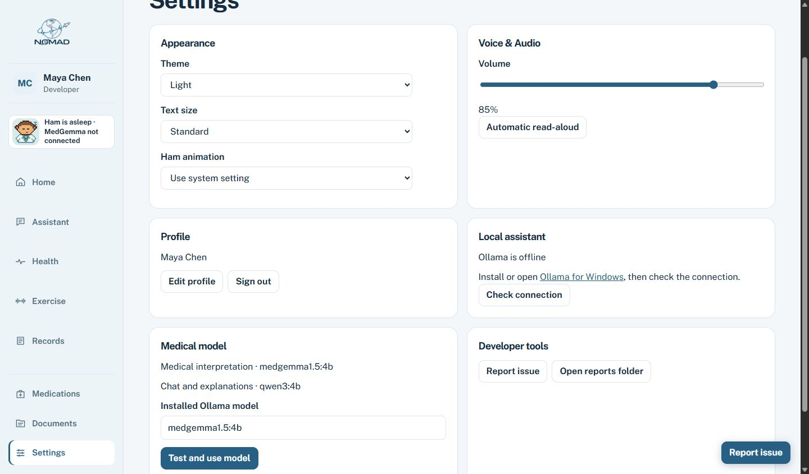</a> <strong><a href="docs/APP-GUIDE.md#local-assistant-setup">Local assistant setup</a></strong> Check Ollama and test the installed MedGemma model.</td></tr>
  <tr><td width="50%"><a href="docs/images/app/25-developer-report.jpg">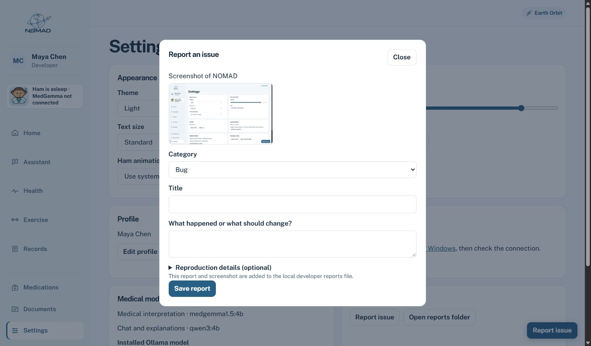</a> <strong><a href="docs/APP-GUIDE.md#developer-issue-report">Developer issue report</a></strong> Save a local issue report with an automatic screenshot.</td><td></td></tr>
</table>

[Full app screen guide](docs/APP-GUIDE.md)

## Sources and references

The [references directory](references/) contains the complete source catalog with **569 indexed Markdown references**, **517 original PDFs** and **five starter notes**.

- **ISS Medical Checklist (2001).** Historical manual with separate ACLS and CPR sections. [ACLS algorithm · PDF page 117](app/knowledge/pages/ISS-Medical-Checklist-2001-117.png) · [CPR · PDF page 145](app/knowledge/pages/ISS-Medical-Checklist-2001-145.png)
- **CPR in microgravity.** The catalog links the European Resuscitation Council guidance, the DGLRM and ESAM-SMG guideline, and the Polaris Dawn study. [Resuscitation sources](references/README.md#start-with-these-references)
- **Spaceflight health.** NASA mission hazards, human systems standards and exercise countermeasures, alongside NIMH mental health publications. [NASA references by topic](references/nasa/) · [Mission library](references/README.md#mission-library)

NOMAD was built for the NASA Space Apps Health Monitoring Software challenge. Ham uses MedGemma for interpretation and Qwen for dialogue and wording through a local Ollama installation. [Challenge brief](https://www.spaceappschallenge.org/2026/challenges/health-monitoring-software/) · [How NOMAD works](docs/ARCHITECTURE.md) · [Project and software credits](references/README.md#project-and-software-credits)

## Repository map

| Folder | What’s inside |
| --- | --- |
| [`app/`](app/) | App interface and assistant logic. [`desktop/`](app/desktop/) holds the Windows host and build scripts, [`tests/`](app/tests/) holds the software checks, [`assets/`](app/assets/) holds visuals and fonts, and [`knowledge/`](app/knowledge/) holds source pages and PDFs packaged with the app. [Ultrasound Samples](app/Ultrasound%20Samples/) contains synthetic practice images. |
| [`docs/`](docs/) | Installation and usage guides, architecture, practice scenarios, project presentation and [screenshots](docs/images/app/). |
| [`downloads/`](downloads/) | Windows ZIP and its [SHA-256 checksum](downloads/SHA256SUMS.txt). |
| [`references/`](references/) | Complete catalog of sources and credits, NASA references by topic and the app’s five starter notes. |
| [`Investigation (.md)/`](Investigation%20%28.md%29/) | Markdown research texts indexed by NOMAD, grouped by topic with the import manifest. |
| [`investigation/`](investigation/) | Original research PDFs with the figures, tables and page layout. |
| [`portable/`](portable/) | Scripts to start and update NOMAD from a portable installation. |
| [`scripts/`](scripts/) | Generator that rebuilds the reference catalog from the repository’s research files and source metadata. |

Run `node --test app/tests/*.test.cjs` from the repository root. The [build instructions](docs/ARCHITECTURE.md#build-from-source) describe how to package Windows builds.

## Feedback

For a bug report, include the NOMAD version, the affected screen, the steps you followed and the expected result. A **Developer** profile can save a report with an in-app screenshot for review before sharing. [Developer reporting](docs/APP-GUIDE.md#developer-issue-report) · [Bug Fixes and issue register](BUG-FIXES.md) · [GitHub Issues](https://github.com/nxczmain/NOMAD_Health_Project/issues)

## Team

`print("Nombre del Equipo")` · Nicolas Jauregui, Oscar Melendez, Andrik Porchas, Marco Alvarado and Luiz Ruiz.

[NASA Space Apps team profile](https://www.spaceappschallenge.org/2026/find-a-team/printnombre_del_equipo/) · [Project presentation](docs/NOMAD-Project-Demonstration.pdf)
