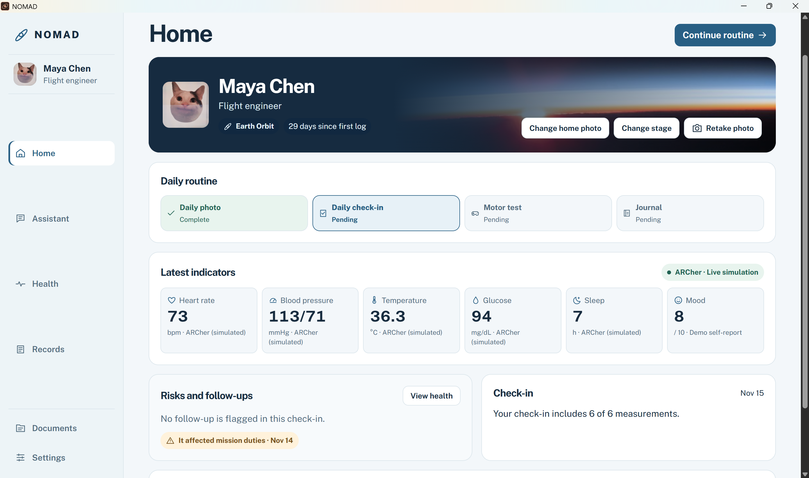
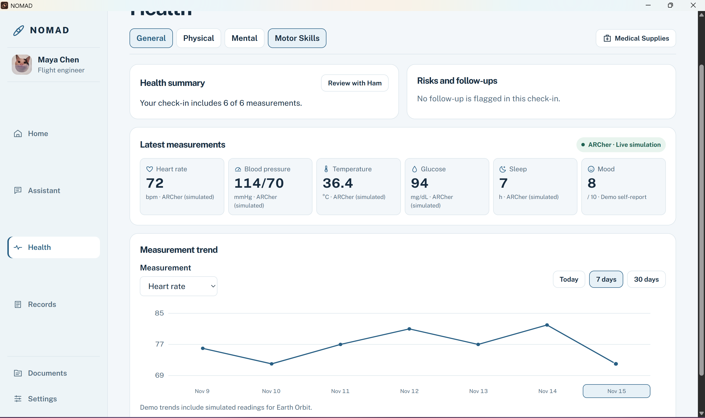
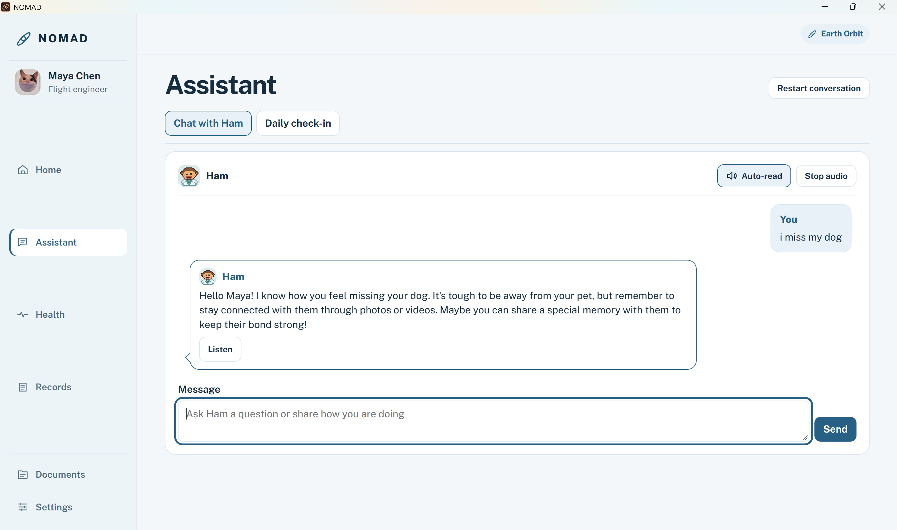
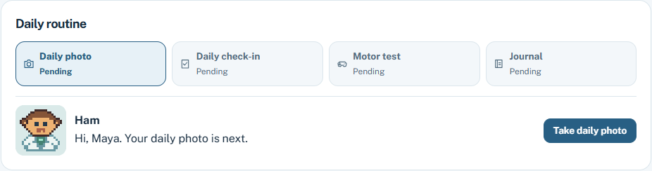
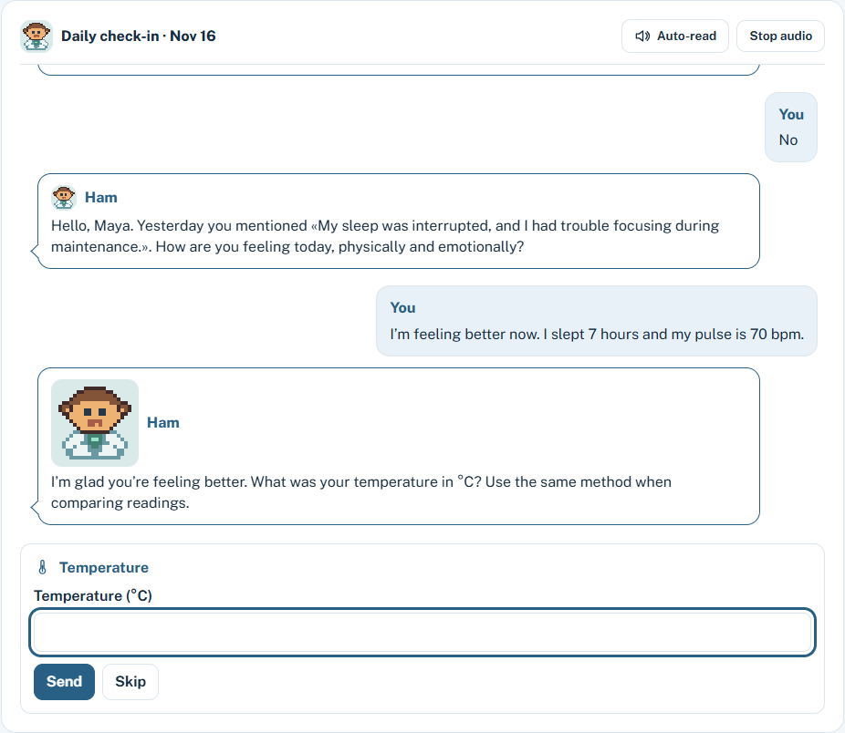
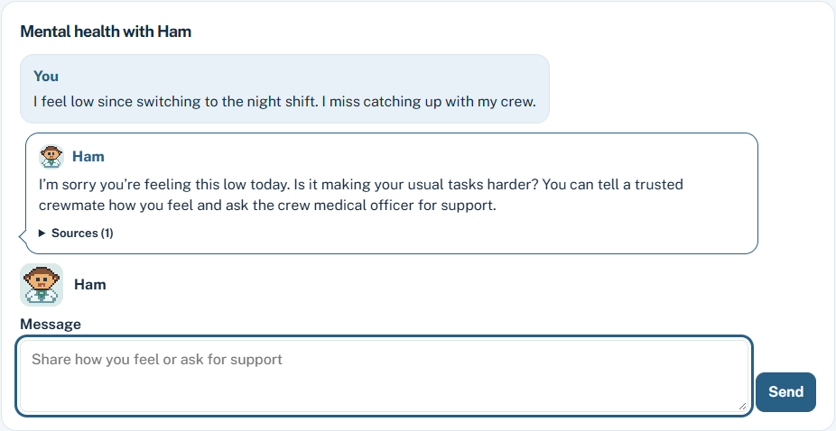
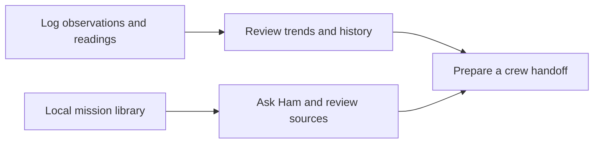

<p align="center">
  
</p>

<h1 align="center">NOMAD</h1>

<p align="center"><strong>A local health workstation for astronaut crews</strong><br>
Record daily observations, track changes over time, and prepare a handoff for the crew medical officer.</p>

<p align="center">Built for the 2026 NASA Space Apps Challenge · <a href="https://www.spaceappschallenge.org/2026/find-a-team/printnombre_del_equipo/">Team page</a></p>

<p align="center">
  <a href="https://github.com/nxczmain/Nasa-Space-Apps/raw/refs/heads/main/downloads/NETIN-Windows-x64.zip"><strong>Download for Windows x64</strong></a>
  · <a href="docs/NOMAD-Project-Demonstration.pdf">Project presentation</a>
  · <a href="#installation">Quick start</a>
  · <a href="#judge-walkthrough">Judge walkthrough</a>
</p>

## Contents

[Mission problem](#the-mission-problem) · [Screenshots](#see-nomad-in-action) · [Ham](#meet-ham) · [Workflow](#from-daily-check-in-to-crew-handoff) · [Installation](#installation) · [Judge walkthrough](#judge-walkthrough) · [Architecture and tests](#how-it-works) · [Repository and research](#repository-and-research) · [Team](#team)

## The mission problem

On long missions, crew members need to recognize health changes and organize what they observed when communication with Earth may be delayed. NOMAD gives each astronaut a local record of symptoms, readings, mood and motor performance. **Ham**, the onboard assistant prototype, asks follow-up questions and retrieves relevant passages from the mission library for the crew to review. [NASA Space Apps challenge](https://www.spaceappschallenge.org/2026/challenges/health-monitoring-software/) · [NASA Human Research Program](https://www.nasa.gov/hrp/hazards/)

## See NOMAD in action

Maya Chen’s Earth Orbit demo shows the daily health routine and the latest simulated readings.



<details>
<summary><strong>Health · Review a seven-day heart rate trend</strong></summary>



</details>

<details>
<summary><strong>Assistant · Chat with Ham</strong></summary>



</details>

## Meet Ham

<p align="center">
  
</p>

Ham is NOMAD’s onboard **AI assistant**, represented by a pixel-art chimpanzee. It runs on the crew workstation using Qwen3 through Ollama. Ham helps crew members describe what they feel, find relevant mission references and organize their observations for the crew medical officer, who makes clinical decisions.

The character is inspired by Ham, the chimpanzee who flew into space aboard NASA’s Mercury-Redstone 2 mission on January 31, 1961. [NASA archival photo and mission details](https://www.nasa.gov/image-article/chimpanzee-ham-with-trainers/)

| What Ham does | What that looks like in NOMAD |
| --- | --- |
| **Adapts the daily check-in** | Acknowledges how the crew member feels now, keeps track of readings they already shared and asks about the next missing detail. |
| **Answers questions and offers support** | Uses the latest message in context. For physical health questions, Ham can show passages from the local Markdown library. In Mental Health, it responds in plain English and suggests a practical next step. |
| **Helps prepare an urgent handoff** | NOMAD’s local safety checks trigger built-in steps as soon as they recognize an urgent report. Ham can keep the crew member’s original wording for responders. |
| **Guides the daily routine** | Shows what’s next on Home, gives directions for the daily photo and motor test, and can summarize saved journal entries. Crew members can adjust read-aloud and animation in Settings. |
| **Reviews simulated ultrasound images** | With the optional Qwen3-VL model, Ham describes visible features in synthetic training images the crew uploads. |

### Ham in the app

These captures use Maya Chen’s demo profile and simulated inputs.

**Home · The next step in the daily routine**



<details>
<summary><strong>Assistant · An adaptive daily check-in</strong></summary>



</details>

<details>
<summary><strong>Mental Health · Support during a shift change</strong></summary>



</details>

## From daily check-in to crew handoff



| In NOMAD | What crew members can do |
| --- | --- |
| **Home** | Follow the daily routine for a photo, check-in, motor tests and journal. Review the latest indicators and follow-ups. |
| **Health → Physical** | Log a symptom on the body map, ask Ham about a physical change or upload a synthetic ultrasound image for training. |
| **Health → Mental** | Record how you feel and talk with Ham about mood, its effect on duties and ways to get support. |
| **Health → General** | Chart heart rate, blood pressure, temperature, blood glucose, sleep duration and mood. |
| **Records** | Review previous observations by date and mission stage. Export a daily report from the current filter. |
| **Assistant** | Chat with Ham, complete an adaptive daily check-in or practice a crew emergency handoff using a simulated report. |
| **Documents** | Browse the starter references or import the complete research collection as Markdown. |

## Installation

**Requirements** · Windows 10 22H2 or Windows 11 (x64), Microsoft Edge WebView2 Evergreen Runtime and .NET Framework 4.8 or later. Internet access is needed for the downloads. A camera is optional. See the [full setup guide](docs/INSTALLATION.md#what-you-need) for runtime links and troubleshooting.

1. **Download and extract** [NETIN-Windows-x64.zip](https://github.com/nxczmain/Nasa-Space-Apps/raw/refs/heads/main/downloads/NETIN-Windows-x64.zip). In File Explorer, right-click the ZIP and choose **Extract All**. Use a writable folder such as `Documents\NETIN`.
2. **Set up Ham.** Install and open [Ollama for Windows](https://ollama.com/download/windows). Run the commands below in PowerShell, confirm `qwen3:4b` appears in the list, and leave Ollama running. The model download is about 2.5 GB. [Qwen3 model details](https://ollama.com/library/qwen3:4b)

   ```powershell
   ollama pull qwen3:4b
   ollama list
   ```

3. **Open `NETIN.exe`** from the extracted folder. Keep `interface` and the WebView2 DLLs beside the executable. Choose a mission stage and sign in with a demo profile.

   | Mission stage | Demo astronaut | Demo password |
   | --- | --- | --- |
   | Earth Orbit | Maya Chen | `OrbitDemo26` |
   | Moon | Mateo Ruiz | `LunarDemo26` |

4. **Check the connection.** In **Settings → Check connection**, look for **Qwen is ready**. The ZIP already includes a starter library with five references. Open **Documents** to see them.

The [installation guide](docs/INSTALLATION.md) covers runtime setup, importing the full research library and common errors. The [SHA-256 file](downloads/SHA256SUMS.txt) lets you verify the ZIP.

### Import the full Markdown research library

1. Download and extract the [repository ZIP](https://github.com/nxczmain/Nasa-Space-Apps/archive/refs/heads/main.zip). Copy the entire `Investigation (.md)` folder, with its subfolders, into your NOMAD folder or another local location.
2. In NOMAD, open **Documents → Load Markdown folder** and select `Investigation (.md)`. Wait for **Local library** to show **504 Markdown files** (503 research documents and the collection README).
3. With Ollama running, open **Assistant** and ask “What does the research library say about sleep and fatigue?” Expand **Sources** in Ham’s answer and select **Open passage** to check the reference.

Each import replaces the loaded library. Select the complete parent folder when updating it. [Research library guide](docs/RESEARCH.md)

## Judge walkthrough

Start with **Maya Chen · Earth Orbit** to review a 30-day synthetic history and try the daily workflow. **Mateo Ruiz · Moon** offers a second mission context.

| Try this | What to look for |
| --- | --- |
| **Assistant → Daily check-in**. Answer **No** to the opening safety question and enter “I’m feeling better now. I slept 7 hours and my pulse is 70 bpm.” | Ham acknowledges the improvement and moves to the next missing item. Select **Save and finish** to review the recap on **Home**. |
| **Health → General**. Under **Measurement trend**, choose **Sleep** and switch between **7 days** and **30 days**. Open **Records** to inspect a previous check-in. | Compare the plotted readings with the observations saved for a date. |
| **Assistant**. Ask “How can an irregular sleep schedule affect my ability to work?” | Read Ham’s answer and open the cited reference passages. |
| **Health → Mental**. In **Mental health with Ham**, enter “I feel low today and miss working with my crew.” | Ham offers a practical next step in plain English and uses the mood conversation for context. |
| **Assistant → Chat with Ham**. In a demo profile, send “My crewmate is unresponsive but breathing. What should I do?” | Ham asks you to stay calm and displays numbered steps for getting help. |

Use the [20 simulated Ham conversations](docs/HAM-SIMULATIONS.md) to try more check-in, physical and mental health scenarios, including urgent reports.

<details>
<summary><strong>Optional demo · Synthetic ultrasound</strong></summary>

1. Run `ollama pull qwen3-vl:4b` with Ollama 0.12.7 or later running. [Qwen3-VL model details](https://ollama.com/library/qwen3-vl:4b)
2. Open **Health → Physical → Ultrasound simulation**.
3. Choose `phantom-dark-target.png` from `Ultrasound Samples`, confirm it is simulated, and select **Analyze with Ham**.


</details>

## How it works

**Desktop and records.** C# WinForms hosts the HTML, CSS and JavaScript interface in WebView2. Browser storage holds the local crew records, daily photos and imported library. The current mission stage is shared on the installation. Saved observations retain their original stage.

**Ham and the mission library.** NOMAD retrieves relevant Markdown passages and passes them to Qwen through Ollama on the same machine. Once setup downloads are complete, the app and model can run locally. Recognized urgent reports trigger a built-in alert before model processing. [Architecture and build instructions](docs/ARCHITECTURE.md)

**Tests.** With Node.js installed, run the conversation and safety tests from the repository root.

```powershell
node --test app/tests/*.test.cjs
```

## Repository and research

| Location | Contents |
| --- | --- |
| [`app/`](app/) | Interface, local assistant and synthetic ultrasound samples |
| [`app/desktop/`](app/desktop/) | WinForms host, Ollama bridge and Windows build script |
| [`app/tests/`](app/tests/) | Conversation and safety regression tests |
| [`docs/`](docs/) | Installation, architecture, research, screenshots and the [project presentation](docs/NOMAD-Project-Demonstration.pdf) |
| [`downloads/`](downloads/) | Windows x64 ZIP and [SHA-256 checksum](downloads/SHA256SUMS.txt) |
| [`references/`](references/) | Five starter references for the demo |
| [`portable/`](portable/) | Scripts for running and updating a USB installation |
| [`Investigation (.md)/`](Investigation%20%28.md%29/) | 503 importable research documents and conversion manifest |
| [`investigation/`](investigation/) | 510 original PDFs, including figures and tables |

The research collection covers in-flight medical conditions, mission risks, first aid and standards. The library guide maps the topics and links to the source files. [Research library](docs/RESEARCH.md) · [NASA data and references](docs/NASA-DATA.md)

> **Prototype status.** The demo uses synthetic crew records and ultrasound images. Operational use requires clinical validation and mission approval.

## Team

`print("Nombre del Equipo")`

- Nicolas Jauregui
- Oscar Melendez
- Andrik Porchas
- Marco Alvarado
- Luiz Ruiz

[Team profile on NASA Space Apps](https://www.spaceappschallenge.org/2026/find-a-team/printnombre_del_equipo/)

Project Presentation (https://www.canva.com/design/DAHa7y80PRY/D-VR3uL69IYG2SafyVAtRw/edit)
