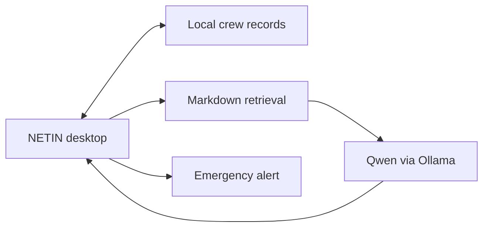

# How NETIN works



The WinForms host serves a bundled HTML, CSS and JavaScript interface through WebView2. The host sends Qwen requests to Ollama over loopback. Local storage holds profile metadata and health logs. IndexedDB stores daily photos and the Markdown library. The shared mission stage is saved per installation and applied across sign-ins. Each logged entry keeps its original stage.

For grounded questions, NETIN ranks passages from the imported Markdown and includes the best matches in the model request. The response includes the reference passages it used. The public evaluation library contains short summaries and source links. Judges and operators can load a mission-specific folder.

NETIN screens responses in the check-in and chat for emergencies. Recognized warning signs trigger immediate action before any model request. For less direct reports, Qwen uses the recent conversation to assess urgency before the app continues. An urgent assessment stops the routine check-in and displays the appropriate directions for Earth or the onboard emergency procedure. Qwen can also extract an exact observation for the handoff.

The two demo profiles are synthetic. Readings flagged for review in the demo use demonstration reference values. The project has undergone scenario and software checks, and requires clinical validation for operational use.

## Technologies

| Component | Technology |
| --- | --- |
| Desktop | C# WinForms, .NET Framework, Microsoft Edge WebView2 |
| Interface | HTML, CSS, JavaScript |
| Local model | Ollama with `qwen3:4b` |
| Local records | WebView2 local storage and IndexedDB |
| Distribution | Windows PowerShell build and a Windows x64 ZIP |

## Build from source

1. Download or clone the repository. Download [Microsoft.Web.WebView2 1.0.2151.40](https://www.nuget.org/packages/Microsoft.Web.WebView2/1.0.2151.40) as a `.nupkg`.
2. From the root of the repository, run this command in Windows PowerShell.

   ```powershell
   powershell -NoProfile -ExecutionPolicy Bypass -File .\app\desktop\Build.ps1 -WebView2Package .\Microsoft.Web.WebView2.1.0.2151.40.nupkg -OutputDirectory .\build
   ```

3. Open `build\NETIN.exe` and follow the Ollama setup in the [installation guide](INSTALLATION.md). In **Documents**, select the repository's `references` folder or your mission Markdown folder.
