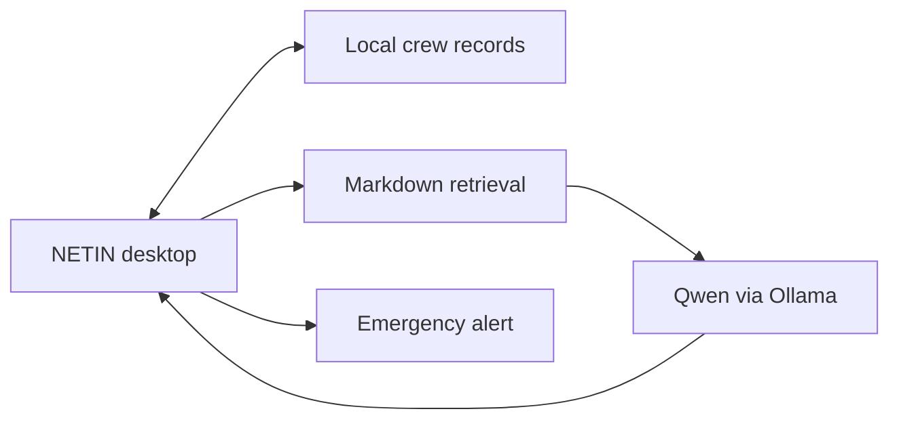

# How NETIN works

The WinForms host serves a bundled HTML, CSS and JavaScript interface through WebView2. The host sends Qwen requests to Ollama over loopback. Local storage holds profile metadata and health logs. IndexedDB stores daily photos and the Markdown library. The shared mission stage is saved per installation and applied across sign-ins. Each logged entry keeps its original stage.

For grounded questions, NETIN ranks passages from the imported Markdown and includes the best matches in the model request. The response includes the reference passages it used. The public evaluation library contains short summaries and source links. Judges and operators can load a mission-specific folder.

When a report matches a recognized emergency, NETIN displays the immediate action before sending any model request. For an unresponsive person, Qwen can extract an exact observation from the report into the handoff. This keeps medical instructions separate from text generation about the event.

The two demo profiles are synthetic. Readings flagged for review in the demo use demonstration reference values. The project has undergone scenario and software checks, and requires clinical validation for operational use.

## Technologies

| Component | Technology |
| --- | --- |
| Desktop | C# WinForms, .NET Framework, Microsoft Edge WebView2 |
| Interface | HTML, CSS, JavaScript |
| Local model | Ollama with `qwen3:4b` |
| Local records | WebView2 local storage and IndexedDB |
| Distribution | Windows PowerShell build and a Windows x64 ZIP |
