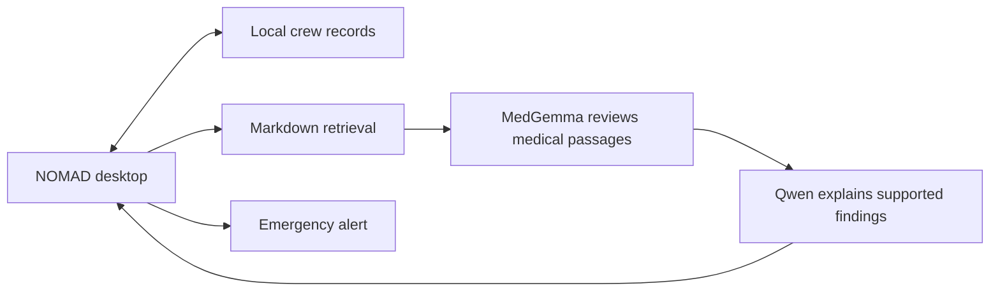

# How NOMAD works



The WinForms host serves a bundled HTML, CSS and JavaScript interface through WebView2. It sends approved model requests to Ollama over loopback. Local storage holds profile metadata and health logs. IndexedDB stores daily photos and the Markdown library. The shared mission stage is saved per installation and applied across sign-ins. Each logged entry keeps its original stage.

For grounded medical questions, NOMAD ranks Markdown passages and asks MedGemma to interpret them. It checks the quoted evidence before giving the supported findings to Qwen, which writes the response with citations. Physical conversations receive relevant symptoms and readings. Mental conversations use mood check-ins and relevant NIMH references. MedGemma also describes manually selected synthetic ultrasound images.

NOMAD screens check-in and chat replies for emergencies. Recognized warning signs trigger immediate action before any model request. For less direct reports, Qwen uses the recent conversation to assess urgency before the app continues. An urgent assessment stops the routine check-in and displays numbered directions for Earth or the onboard emergency procedure. Qwen can also extract an exact observation for the handoff.

The two demo profiles are synthetic. Readings flagged for review in the demo use demonstration reference values. The project has undergone scenario and software checks, and requires clinical validation for operational use.

## Technologies

| Component | Technology |
| --- | --- |
| Desktop | C# WinForms, .NET Framework, Microsoft Edge WebView2 |
| Interface | HTML, CSS, JavaScript |
| Local models | Ollama with `medgemma1.5:4b` for medical interpretation and synthetic ultrasound, and `qwen3:4b` for explanations and dialogue |
| Local records | WebView2 local storage and IndexedDB |
| Distribution | Windows PowerShell build and a Windows x64 ZIP |

## Build from source

1. Download or clone the repository. Download [Microsoft.Web.WebView2 1.0.2151.40](https://www.nuget.org/packages/Microsoft.Web.WebView2/1.0.2151.40) as a `.nupkg`.
2. From the root of the repository, run this command in Windows PowerShell.

   ```powershell
   powershell -NoProfile -ExecutionPolicy Bypass -File .\app\desktop\Build.ps1 -WebView2Package .\Microsoft.Web.WebView2.1.0.2151.40.nupkg -OutputDirectory .\build
   ```

3. Open `build\NETIN.exe` and follow the Ollama setup in the [installation guide](INSTALLATION.md). The build bundles the research Markdown and the page images and originals referenced by the local library.

## Run the regression tests

From the repository root, run `node --test app/tests/*.test.cjs` with Node.js. See the [20 simulated Ham conversations](HAM-SIMULATIONS.md) for the case inputs and expected behavior.
